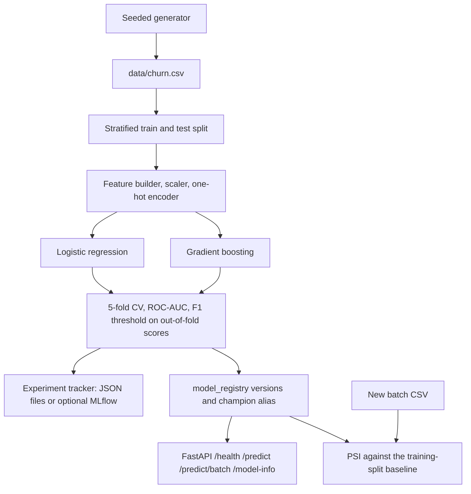

# Customer churn prediction with a local MLOps loop

Portfolio project by **Alexandru Cojocari** for a junior AI / Python / data role.

A seeded synthetic subscription book is scored with two scikit-learn models. Training writes a local experiment log, registers versioned artifacts, and promotes a champion. A FastAPI service scores new customers. A Population Stability Index (PSI) check compares a later batch with the training baseline. Everything needed to test and score runs offline. There are no paid API keys.

## Problem

A subscription business wants a ranked list of customers who may leave, plus a record of how that score was produced. The useful output is a probability and a yes/no decision at a chosen threshold. The operating point has to be picked without peeking at the final test set. A later batch of customers may not look like the training book, so the pipeline also measures marginal drift before anyone treats new scores as comparable.

The table is synthetic. It follows the shape of a telecom or SaaS billing extract: contract, tenure, charges, support load, usage, and a few add-ons. Labels are Bernoulli draws from a logistic function of those fields, plus Gaussian noise, so the classes overlap. The shifted scenario keeps the same labeling rule and changes the mix of contracts, prices, tenure, tickets, satisfaction, and payment behavior. That is covariate shift, which is what PSI is meant to catch.

## Architecture



| Piece | Role |
| --- | --- |
| `src/churn/data/generate.py` | Seeded customers. `baseline` and `shifted` share the labeling rule. |
| `src/churn/features/engineering.py` | Medians fit on train only. Ratios, flags, scaling, one-hot with unknown levels ignored. |
| `src/churn/training/` | Logistic regression and gradient boosting, stratified CV, ROC-AUC, F1 threshold. |
| `src/churn/tracking/tracker.py` | One JSON directory per run. MLflow is optional and falls back to files. |
| `src/churn/registry/store.py` | `model_registry/v00N/` plus `index.json` aliases. |
| `src/churn/drift/psi.py` | PSI on raw inputs. Bands: under 0.10 stable, under 0.25 minor, otherwise major. |
| `src/churn/serving/` | FastAPI app and pydantic request models. |
| `model_registry/` | Champion `v001` (logistic regression) and `v002` (gradient boosting). |
| `reports/` | Training and drift JSON from the run documented below. |

Engineered fields, all fit without the label: `charges_per_tenure`, `billing_gap` (list price minus average charge, a stand-in for credits), `tickets_per_tenure`, `gb_per_dollar`, `new_customer` (tenure under 6 months), `low_satisfaction`, `contract_risk`, `has_fiber`, `unprotected` (internet with neither security nor tech support), and `addon_count`.

The decision threshold is chosen on out-of-fold training scores. The grid runs from 0.05 to 0.95 in steps of 0.01. The cutoff with the highest F1 wins. Ties prefer the cutoff closest to 0.5, then the lower cutoff. The test set is scored once after that choice. The champion is the model with the higher mean stratified CV ROC-AUC. A tie would break on out-of-fold F1.

## Quickstart

Requires Python 3.11 or 3.12. Direct dependencies are pinned in `pyproject.toml` to the versions that produced the sample results (scikit-learn 1.9.1, numpy 2.5.4, pandas 3.1.1).

```bash
python3 -m venv .venv
source .venv/bin/activate
pip install -e ".[dev]"
make test
make serve
```

`make serve` loads the committed champion on port 8000. Interactive docs are at `http://127.0.0.1:8000/docs`.

Reproduce the datasets and a fresh registry:

```bash
make generate
rm -rf model_registry experiments
make train
make drift
```

`make train` on a registry that already contains `v001` and `v002` appends later versions and moves the `champion` alias. Delete `model_registry/` first if the goal is to recreate the committed versions. With seed 42 and the default CLI settings, the metrics match `reports/training_report.json`.

Optional MLflow tracking, still local, with a file fallback when the package is absent:

```bash
pip install -e ".[mlflow]"
CHURN_TRACKING=mlflow python -m churn train --data data/churn.csv --seed 42
```

`CHURN_TRACKING=mlflow` uses MLflow when it imports, and writes JSON files when it does not. `--tracking file` always writes files. `--tracking mlflow` raises if MLflow is missing. Tests use the file backend and do not need a tracking server.

## Sample results

These figures come from running the commands below in this environment on 2026-11-05. Exact values are in `reports/training_report.json` and `reports/drift_report.json`. The generator printed the churn rates while writing the CSVs.

```bash
python -m churn generate --rows 8000 --seed 42 --output data/churn.csv
python -m churn generate --rows 8000 --seed 42 --scenario shifted --output data/churn_shifted.csv
python -m churn train --data data/churn.csv --seed 42 --report reports/training_report.json
python -m churn drift --current data/churn_shifted.csv --output reports/drift_report.json
```

Baseline file: 8,000 rows, churn rate **0.1985**. Shifted file: 8,000 rows, churn rate **0.531625**. The higher rate is the same labeling rule on a riskier mix, so it is a property of that stress batch. Stratified split: 6,400 train rows, 1,600 test rows (318 churners and 1,282 stayers). Five stratified folds. Report `trained_at` is `2026-11-05T21:02:58+00:00`.

| Metric | Logistic regression `v001` (champion) | Gradient boosting `v002` |
| --- | ---: | ---: |
| CV ROC-AUC mean | 0.7256619238384676 | 0.7102861045878037 |
| CV ROC-AUC std | 0.0012046087209626132 | 0.008848153962239834 |
| Out-of-fold F1 | 0.4443765281173594 | 0.4299363057324841 |
| Test ROC-AUC | 0.7337125560494118 | 0.7146533031132566 |
| Test F1 | 0.4468599033816425 | 0.42735042735042733 |
| Test precision | 0.3627450980392157 | 0.32362459546925565 |
| Test recall | 0.5817610062893082 | 0.6289308176100629 |
| Test Brier (lower is better) | 0.21039182157850128 | 0.1435325200456038 |
| Threshold | 0.56 | 0.2 |
| Test TP, FP, TN, FN | 185, 325, 957, 133 | 200, 418, 864, 118 |

Selection followed the CV ROC-AUC rule, so logistic regression is the champion (`class_weight="balanced"`, `C=1.0`). Gradient boosting (120 trees, learning rate 0.08, max depth 3, subsample 0.9) has the lower Brier score on the same test set. A team that needs calibrated probabilities would read `v002` and set its own threshold. The alias rule does not do that automatically.

Champion metadata `trained_at` is `2026-11-05T21:02:51+00:00`. At threshold 0.56 the test set prediction rate is 0.31875, above the 0.1985 base rate, with 325 false positives and 133 false negatives.

PSI compares `data/churn_shifted.csv` with the champion baseline (the 6,400-row training split). `max_psi` is 0.9882574665790824. Nine features are a major shift and three more are minor. The report's recommendation is: "Review this batch before treating scores as comparable to training. At least one feature has a major marginal shift. This check does not retrain the model."

| Feature | PSI | Status |
| --- | ---: | --- |
| tenure_months | 0.9882574665790824 | major_shift |
| monthly_charges | 0.9497235959725792 | major_shift |
| support_tickets_90d | 0.7649308218478188 | major_shift |
| avg_monthly_gb | 0.5920177683165465 | major_shift |
| satisfaction_score | 0.5132151770304864 | major_shift |
| contract | 0.33854659796015285 | major_shift |
| payment_method | 0.30857861579674917 | major_shift |
| total_charges | 0.3038965873856962 | major_shift |
| autopay | 0.2673661999688414 | major_shift |
| tech_support | 0.1488654631033246 | minor_shift |
| online_security | 0.13772691951385008 | minor_shift |
| internet_service | 0.1302540616312524 | minor_shift |
| paperless_billing | 0.09485065200210013 | stable |
| streaming_tv | 0.05178943187052554 | stable |
| region | 0.00013216235466957635 | stable |
| senior_citizen | 0.00006527222776100122 | stable |
| dependents | 0.000002812092992151253 | stable |
| partner | 0.0000015654036651570932 | stable |

Region, senior citizen, partner, and dependents stay near zero because the shifted scenario does not change their sampling distributions. The small residuals are sampling noise against the training split.

Scored with the running API (same champion) on the first two rows of `data/churn.csv`. Stored labels are 0 and 1. These two calls illustrate the payload; the table above is the evaluation.

`POST /predict` for `C000001`:

```json
{
  "customer_id": "C000001",
  "churn_probability": 0.17795492162382548,
  "churn_prediction": false,
  "threshold": 0.56,
  "model_version": "v001"
}
```

`POST /predict/batch` also scored `C000002` at probability `0.5892533578755365`, prediction `true`, same threshold and version.

Request body for `C000001`:

```json
{
  "customer_id": "C000001",
  "tenure_months": 30,
  "contract": "one_year",
  "internet_service": "fiber",
  "payment_method": "bank_transfer",
  "monthly_charges": 97.6,
  "total_charges": 2956.61,
  "paperless_billing": true,
  "senior_citizen": false,
  "partner": true,
  "dependents": true,
  "online_security": "no",
  "tech_support": "yes",
  "streaming_tv": "yes",
  "support_tickets_90d": 1,
  "avg_monthly_gb": 161.6,
  "satisfaction_score": 5,
  "autopay": true,
  "region": "west"
}
```

`GET /health` returned `{"status":"ok","model_loaded":true,"model_version":"v001"}`.

## Runbook

1. **Create a virtualenv and install.** `pip install -e ".[dev]"`. Use Python 3.11+.
2. **Generate data.** `make generate` writes `data/churn.csv` and `data/churn_shifted.csv` with seed 42 and 8,000 rows. Any other seed is a different book.
3. **Train.** `make train` fits both models, writes `experiments/<run>/` (`meta.json`, `params.json`, `metrics.json`), registers the next versions, promotes `champion`, and writes `reports/training_report.json`.
4. **Read the registry.** `model_registry/index.json` lists versions and aliases. Each version directory holds `model.joblib`, `metadata.json`, and `drift_baseline.json`. Joblib uses pickle. Load only artifacts this project wrote.
5. **Check drift.** `make drift` scores `data/churn_shifted.csv` against the champion baseline. PSI under 0.10 is `stable`, under 0.25 is `minor_shift`, and 0.25 or above is `major_shift`. Shares use additive smoothing of `1e-6`, so a feature compared with itself has PSI 0. A major result means the batch should be reviewed before scores are treated as comparable to training. The command does not retrain and does not move the champion.
6. **Serve.** `make serve` binds `0.0.0.0:8000`. `python -m churn serve` binds `127.0.0.1:8000`. `CHURN_REGISTRY_DIR` overrides the registry path. `/health` is liveness and stays 200 when no champion is loaded; `model_loaded` is the readiness flag. `/predict` and `/model-info` return 503 until a champion exists.
7. **Docker.** `make docker-build` builds `churn-mlops:local`. The image copies `model_registry/` and sets `CHURN_REGISTRY_DIR=/app/model_registry`. The container listens on port 8000 and has a `/health` check.
8. **CI locally.** `make ci` runs Ruff and pytest. GitHub Actions does the same on pull requests and on pushes to `main` (`.github/workflows/ci.yml`).
9. **After a bad batch.** Keep the champion. Inspect `reports/drift_report.json`. Decide whether the shift is expected (a deliberate change in who is being sold to) or a data bug. Retrain with `make train` only after that decision, then promote explicitly by running training, which promotes the new winner.

API summary:

| Method | Path | Body |
| --- | --- | --- |
| GET | `/health` | Liveness and whether a champion is loaded. |
| GET | `/model-info` | Champion name, version, threshold, hyperparameters, metrics. |
| POST | `/predict` | One `CustomerFeatures` object. |
| POST | `/predict/batch` | `{"customers": [...]}` with 1 to 500 rows. |

Unknown JSON fields are rejected. Category values are the generator's literals (`month_to_month`, `one_year`, `two_year`, and the matching internet, payment, add-on, and region sets).

## Tests

`make test` runs the offline suite with coverage. Training tests use a few hundred rows and a small forest. The file tracker is the tracking backend under test. MLflow is exercised with a fake client, and the import-failure fallback is covered by blocking the import. The API tests use FastAPI's `TestClient` against a temporary registry. `tests/test_shipped.py` loads the committed champion and checks it against `reports/training_report.json`.

## Honest limitations

- The customers are synthetic. The label depends on a formula I wrote, so these ROC-AUC numbers describe recovery of that formula under noise. A real billing extract will be messier, and the same pipeline can land lower.
- F1 weights false positives and false negatives equally. On the 1,600-row test set the champion flags 325 customers who stay and misses 133 who leave. A retention offer has a real cost and a real save rate. The threshold should be reset with that cost before anyone spends money on it. The grid and the chosen cutoff are in the training report so that reset is straightforward.
- The champion rule optimizes ranking (CV ROC-AUC). On this run gradient boosting has a better Brier score (0.1435325200456038 versus 0.21039182157850128). Balanced class weights also move logistic-regression probabilities away from the base rate. Use the Brier score, or a calibration plot on fresh labeled data, before treating a probability as a frequency.
- PSI compares one feature at a time. It misses dependence changes and it misses concept drift, where the covariates look familiar and the reasons people leave have changed. Labels are not required for PSI, and PSI does not use them.
- There is one stratified random split. The synthetic rows have no signup date, so there is no temporal backtest.
- Hyperparameters are fixed in `TrainConfig`. There is no search across learning rates or tree sizes, and the booster is scikit-learn's `GradientBoostingClassifier`.
- The API has no authentication, no rate limit beyond the 500-row batch cap, and no shadow or canary routing. `/health` only tells you the process is up and whether a champion file loaded.
- The service scores the raw fields in the request. It does not join a feature store, and it will happily score a customer the drift check would have flagged.
- Artifacts are local JSON and joblib files. The file tracker is single-machine. MLflow is a thin adapter, not a deployed tracking server.
- `senior_citizen` is included because it appears on the classic public telco churn table. This synthetic set is not a fairness evaluation. A real rollout needs a separate review of error rates across groups.
- The shifted churn rate of 0.531625 is the stress scenario. It is not an estimate of a normal month. The baseline rate of 0.1985 is the book the model was trained on.

## License

MIT. See [LICENSE](LICENSE). Copyright 2026 Alexandru Cojocari.
